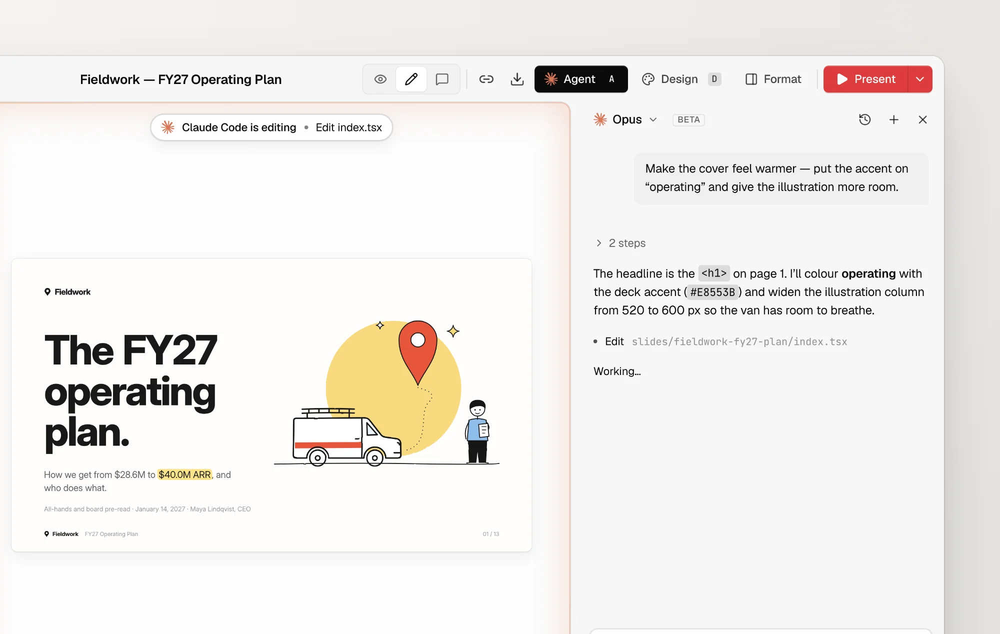
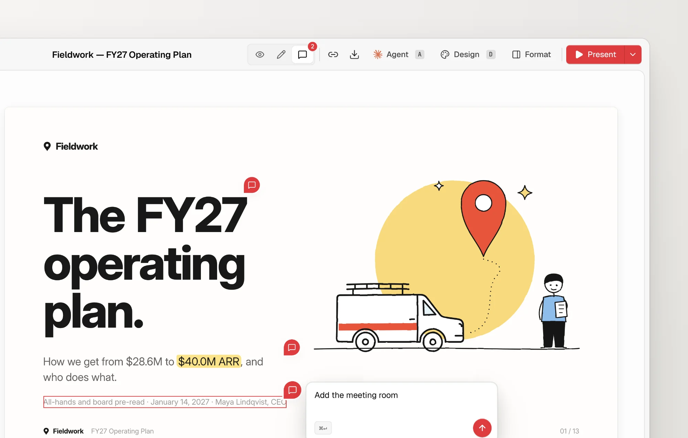
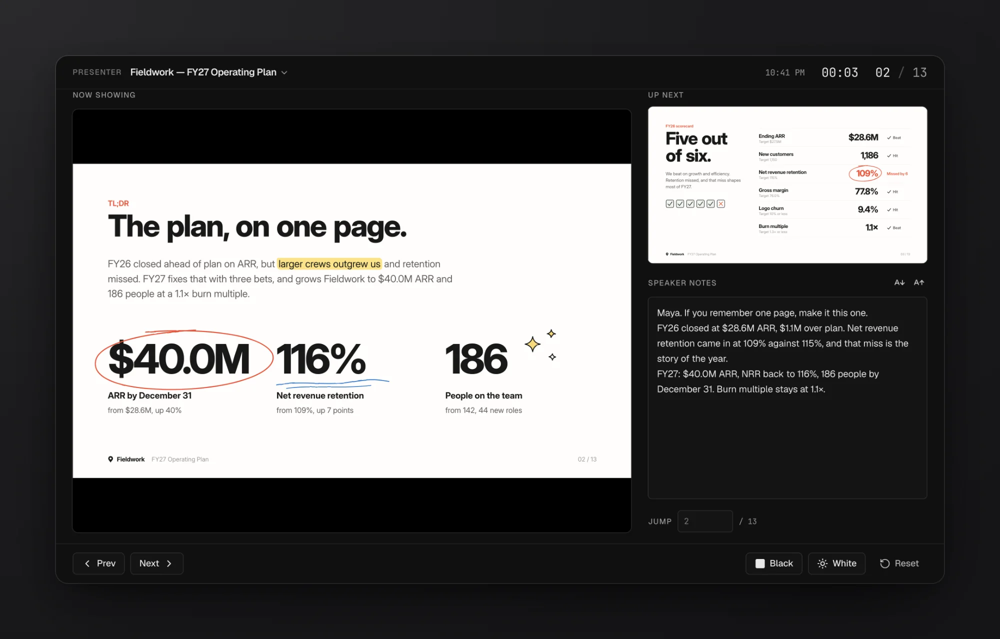

# open-slide

[](https://github.com/kywk/open-slide/stargazers)
[](https://github.com/kywk/open-slide/network/members)
[](https://opensource.org/licenses/MIT)

> [!IMPORTANT]
> **Downstream Fork & Upstream Attribution**
> This repository is an active downstream fork of [open-slide/open-slide](https://github.com/open-slide/open-slide), created and maintained by [@1weiho](https://github.com/1weiho) ([Yiwei Ho](https://github.com/1weiho)).
>
> We track and merge upstream releases regularly while providing extended capabilities focused on vector diagramming, Pele integration, and visual diagram workflows. Published under the `@kywk` scope (`@kywk/open-slide-core` and `@kywk/open-slide-cli`).

The slide framework built for agents. Describe a deck, and your coding agent writes it as React. open-slide handles the canvas, scaling, navigation, hot reload, editing, and present mode.

Every page is a React component rendered on a fixed 1920 × 1080 canvas.

```bash
npx @kywk/open-slide-cli init my-slide
cd my-slide
pnpm install
pnpm dev
```

> [!NOTE]
> **Don't need the fork extensions?**
> If you only require standard open-slide without our diagramming additions (such as Pele-rendered `<Mermaid>`, `<InlineSvg>` lightbox, and diagram-design routing), please install and use the official upstream version directly:
> ```bash
> npx @open-slide/cli init my-deck
> ```
> Visit the official [upstream repository](https://github.com/open-slide/open-slide) and the official [open-slide documentation](https://open-slide.dev) for standard usage.

[Documentation](https://open-slide.dev/docs) · [Changelog](https://open-slide.dev/changelog)

## Agent panel

Connect the Claude Code or Codex CLI you already use and drive it from the browser. Press `A` on any slide to open the panel.



- **Draft a deck.** Click New deck on the home page and describe it. The agent writes it page by page while the canvas follows along.
- **Edit what you see.** The current slide, page, and selected element go along with every message, so "make this bigger" just works.
- **Apply comments** with one click from the comment bar.
- **Uses your existing login.** The SDK installs into the workspace the first time you open the panel. No API keys to configure.

Prefer the terminal? The bundled skills (`/create-slide`, `/apply-comments`, `/create-theme`) work with any coding agent, including Claude Code, Codex, Cursor, and others.

## Comment mode

Press `C`, click an element or drag across a region, and leave a note. Notes are saved as `@slide-comment` markers in the source, and the agent applies them all in one pass.



## Present mode

Fullscreen playback with keyboard navigation, and a presenter view with the next slide, speaker notes, and a timer.



## Also included

- Visual editor with drag, resize, alignment guides, and inline text editing
- Themes, page transitions, step-by-step reveals, and shared-element morphs
- Assets manager with brand logo search via [svgl](https://svgl.app) and Google Fonts
- Export to static HTML, PDF, and PPTX
- Static build that deploys to Vercel, Cloudflare Pages, Netlify, or any static host

For detailed documentation on all core capabilities, please visit the official documentation:

| Feature | Official Documentation |
| --- | --- |
| Agent-native authoring & agent panel | [Agent Guide](https://open-slide.dev/docs/core-feature/agent) |
| Multi-format export (HTML, PDF, PPTX) | [Export Guide](https://open-slide.dev/docs/core-feature/export) |
| Deck & theme management | [Themes](https://open-slide.dev/docs/core-feature/themes) |

## Fork Extensions

This fork extends open-slide with **production-grade technical and editorial diagramming capabilities**, making it easy for AI agents and human authors to embed, theme, and interact with diagrams.

### 1. Vector-Native `<Mermaid>` Powered by Pele

Unlike upstream, which lacks built-in diagramming, this fork integrates **Pele** as the Mermaid rendering engine:

- **Zero-Config Design Token Harmonization**: Diagrams render as clean SVGs that automatically inherit open-slide's CSS theme variables (`--osd-bg`, `--osd-text`, `--osd-accent`, `--osd-font-body`). They adapt dynamically to light/dark themes and Design panel color adjustments without hardcoded hex values.
- **Interactive Lightbox (Click-to-Expand)**: Every `<Mermaid>` diagram supports click-to-expand out of the box, allowing viewers to inspect intricate flowcharts and architecture diagrams full-screen during a presentation.
- **Custom Pele Overrides**: Pass `--pele-*` variables directly via `style` to customize specific diagrams:
  ```tsx
  import { Mermaid } from '@kywk/open-slide-core';

  const pipeline = `
  graph LR
    A[Raw Prompt] --> B[Agent Model]
    B --> C{Decision}
    C -->|Code| D[React Page]
    C -->|Visual| E[Vector Diagram]
  `;

  <Mermaid
    chart={pipeline}
    style={{
      width: 1680,
      height: 600,
      '--pele-accent': '#6366f1',
    }}
    lightbox
  />
  ```

### 2. `<InlineSvg>` Component with Lightbox

For complex static SVGs (such as editorial diagrams generated from external skills, design tools, or raw vector assets), embed them via `<InlineSvg>`:

```tsx
import { InlineSvg } from '@kywk/open-slide-core';
import architectureSvg from './assets/system-arch.svg?raw';

<InlineSvg
  svg={architectureSvg}
  alt="System Architecture Diagram"
  lightbox
/>
```

- **Built-in Normalization**: Automatically normalizes `viewBox`, scales responsively within pixel-bound containers, and provides accessibility labels.
- **Lightbox Support**: Full-screen modal expansion by default. Pass `lightbox={false}` for purely decorative marks.

### 3. Diagram Routing & Authoring Decision Tree

Our built-in agent skill references (`packages/core/skills/slide-authoring/references/diagrams.md` and `mermaid.md`) teach coding agents how to choose the right visualization strategy:

```
Is the `diagram-design` skill available?
├─ YES → Can diagram-design handle this type (architecture, sequence, sankey, flywheel, etc.)?
│        ├─ YES → Use `diagram-design` → output SVG → embed with `<InlineSvg lightbox />`
│        └─ NO  → Use `<Mermaid lightbox />`
└─ NO  → Use `<Mermaid lightbox />`
```

#### Canvas Layout Tips for 1920 × 1080
- **Full-Width (Default)**: Best for wide and shallow diagrams (`flowchart LR`, shallow ER). Heading and subtitle above, diagram below (`width: 1680, height: 560`).
- **Two-Column**: Best for tall and narrow flows (sequence diagrams, deep trees). Text narrative on the left (760px), diagram on the right (760px).
- **Full-Bleed**: For dense system architectures where the diagram is the hero element. Use a small top eyebrow label and allocate the canvas (`width: 1800, height: 960`).
- **Concise Node Labels**: Aim for **3–5 words maximum** per node label. Use `<br/>` for intentional line breaks (`A["Build<br/>container"]`). If a diagram exceeds 15–20 nodes, split across multiple slides rather than shrinking labels beyond legibility.

## Repository

| Path | Package | Role |
| --- | --- | --- |
| [`packages/core`](packages/core) | `@kywk/open-slide-core` | Runtime (viewer, present mode, inspector, Pele Mermaid, InlineSvg), Vite plugin, CLI. |
| [`packages/cli`](packages/cli) | `@kywk/open-slide-cli` | `npx @kywk/open-slide-cli init` scaffolder + project template. |
| [`apps/demo`](apps/demo) | private | Example workspace consuming local `@kywk/open-slide-core` via `workspace:*`. |
| [`apps/web`](apps/web) | private | Documentation and landing site. |

```bash
pnpm install
pnpm dev          # Run demo against local core
pnpm build        # Build all packages
pnpm typecheck
pnpm check        # Biome format & lint check
pnpm test         # Unit tests (Vitest)
```

To sync package scopes after merging upstream:
```bash
node scripts/rename-scope.mjs --write
pnpm check:fix
```

See [CONTRIBUTING.md](CONTRIBUTING.md) before opening a pull request.

## Support

<a href="https://vercel.com/open-source-program"></a>

open-slide was originally designed and built by [Yiwei Ho (@1weiho)](https://github.com/1weiho). If open-slide has been useful to you, consider supporting development:

- Original Repository: [github.com/open-slide/open-slide](https://github.com/open-slide/open-slide)
- Official Documentation: [open-slide.dev](https://open-slide.dev)

<a href="https://buymeacoffee.com/1weiho"></a>

## License

MIT License.

Original work Copyright © 2026 [Yiwei Ho](https://github.com/1weiho).
Fork modifications Copyright © 2026 [Yu Zhi Chen (@kywk)](https://github.com/kywk).
